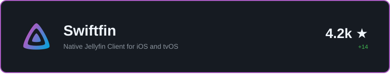
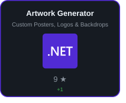
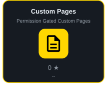
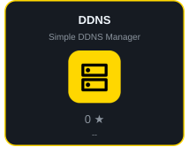
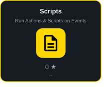
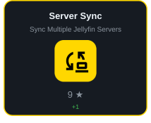

<!--
  Layout notes:
  - GitHub's profile README column (article.markdown-body, measured Jul
    2026): FIXED 846px at viewports ≥1280; fluid below (viewport−434 at
    1012-1279, viewport−370 at 768-1011, viewport−82 under 768). GitHub
    strips CSS, so a fixed-size card grid can only fill the column exactly
    in the fixed ≥1280 tier — everywhere else only a 100%-width image can
    track the fluid column. Hence:
      * ≥1280: desktop grid. Each card has a percentage width (GitHub
        keeps width="%" on images), so every row fills the column at any
        width. Rows and widths are computed from the plugin count.
      * ≤1011: every plugin card swaps (via <picture><source>) to its
        "-mobile" tile, an icon and name with the same viewBox as the desktop
        card, so it fills the same percentage slot and stays legible at a
        quarter of a phone's column.
      * ≤767: the header/Swiftfin/footer cards also swap to mobile variants
        with larger type for phone legibility. They carry width="100%" so
        they fill the column at every size (the old width="800" capped them
        under the 846 column).
  - Gaps are baked into the SVGs as transparent padding: desktop cards
    carry half the gutter on each inner edge (none on a row's outer edges,
    so rows line up flush with the full width cards) and a 10 unit bottom
    pad (except the footer); the header, Swiftfin and footer
    mobile cards a 20px bottom pad, which scales with the card so stacked
    gaps stay proportional.
  - Rows use 
 (no margins, unlike 
) and images are butted together
    with zero whitespace so widths are exact. All plugin cards live in one
    
 that generate-cards.sh rebuilds between the plugins markers from
    its PLUGINS list. The script balances them into rows of at most four
    and gives each card a percentage width matching its share of the row
    (minus a hair), so a row never wraps even though GitHub's column width
    changes.
  - align="top" (vertical-align: top) collapses each line box to the image
    height, removing the font-descent gap that default baseline alignment
    adds below each row. Note: the legacy align="bottom" maps to
    vertical-align: baseline, which does NOT remove it.
-->

<a href="https://joseph.kribs.net"><picture><source media="(max-width: 767px)" srcset="cards/header-mobile.svg"></picture></a>

<a href="https://github.com/jellyfin/Swiftfin"><picture><source media="(max-width: 767px)" srcset="cards/swiftfin-mobile.svg"></picture></a>

<!-- plugins:start -->

<a href="https://github.com/JPKribs/jellyfin-plugin-artworkgenerator"><picture><source media="(max-width: 1011px)" srcset="cards/poster-mobile.svg"></picture></a><a href="https://github.com/JPKribs/jellyfin-plugin-custompages"><picture><source media="(max-width: 1011px)" srcset="cards/custompages-mobile.svg"></picture></a><a href="https://github.com/JPKribs/jellyfin-plugin-livechannels"><picture><source media="(max-width: 1011px)" srcset="cards/livechannels-mobile.svg"></picture></a><a href="https://github.com/JPKribs/jellyfin-plugin-remoteaccess"><picture><source media="(max-width: 1011px)" srcset="cards/ddns-mobile.svg"></picture></a><a href="https://github.com/JPKribs/jellyfin-plugin-scripts"><picture><source media="(max-width: 1011px)" srcset="cards/scripts-mobile.svg"></picture></a><a href="https://github.com/JPKribs/jellyfin-plugin-serversync"><picture><source media="(max-width: 1011px)" srcset="cards/sync-mobile.svg"></picture></a><a href="https://github.com/JPKribs/jellyfin-plugin-usermanagement"><picture><source media="(max-width: 1011px)" srcset="cards/usermgmt-mobile.svg"></picture></a><a href="https://github.com/JPKribs/jellyfin-plugin-youtubeaudio"><picture><source media="(max-width: 1011px)" srcset="cards/youtube-mobile.svg"></picture></a>

<!-- plugins:end -->

<a href="https://joseph.kribs.net"><picture><source media="(max-width: 767px)" srcset="cards/footer-mobile.svg"></picture></a>

